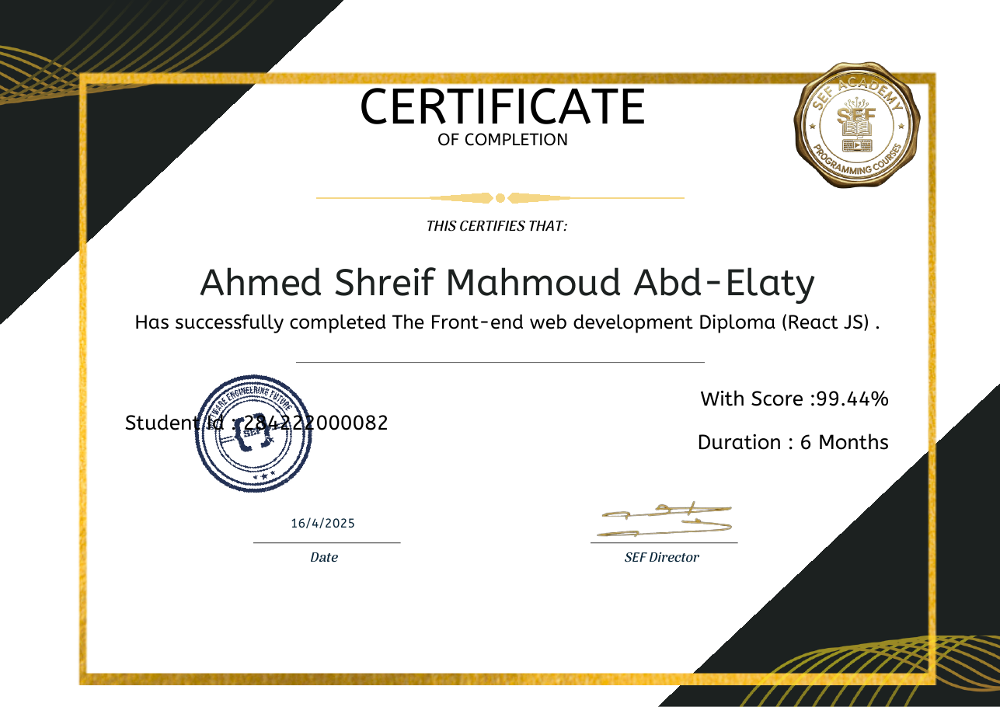
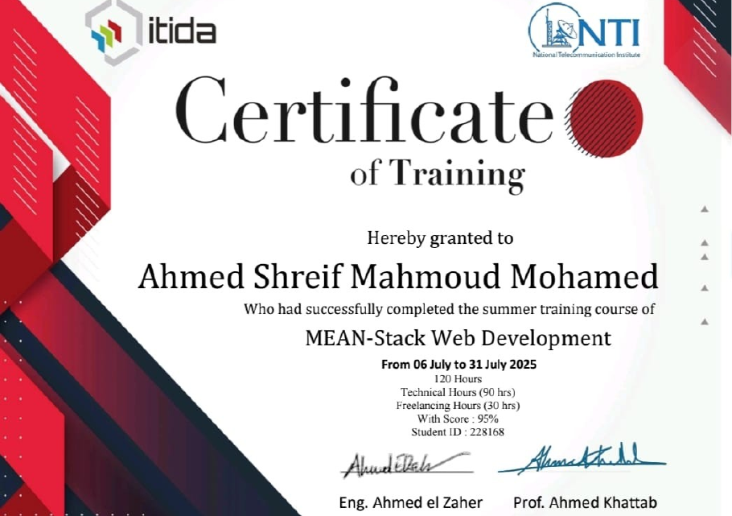
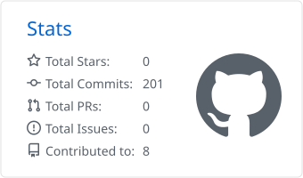
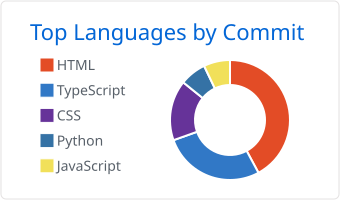

 

 

## About

Computer and Communications Engineering (CCE) student at **Mansoura University**, focused on building clean, responsive web interfaces and exploring how software connects with AI and embedded hardware.

I am currently a front-end student in the **Route Academy** diploma, and I have completed the **SEF Academy** Front-End Diploma (React JS) and the **NTI** MEAN-Stack summer training. Alongside web development, I work on computer vision and IoT-style systems, combining Python, YOLOv8 and Raspberry Pi.

**Currently**
- Studying the Front-End Diploma at Route Academy
- Strengthening my skills with React and TypeScript
- Building applied AI projects with real-time detection
- Looking for internship and junior developer opportunities

 

## Tech Stack

 

## Featured Projects

| Project | Overview | Stack |
| :-- | :-- | :-- |
| [**Industrial Product Inspection System**](https://github.com/Ahmedshreif-code/industrial-product-inspection-system) | AI-powered production line inspection with real-time defect detection and automation. | Python, YOLOv8, Raspberry Pi, Flask |
| [**Portfolio (NTI Final Project)**](https://github.com/Ahmedshreif-code/protfolio-NTI-final-project) | Personal portfolio website built as the final project at NTI. |  Angular, TypeScript |
| [**Route Tasks**](https://github.com/Ahmedshreif-code/Route-Tasks) | Front-end tasks and exams from Route Academy, each with a live demo and source code. | HTML, CSS, JavaScript, TypeScript, React, Tailwind, Bootstrap |
| [**E-commerce (Route x Orange)**](https://github.com/Ahmedshreif-code/Ecommerce-Rote-X-Orange) | Responsive e-commerce website. | HTML, CSS, Bootstrap, JavaScript |
| [**Guess the Number**](https://github.com/Ahmedshreif-code/Guess-the-number-Game) | Interactive number guessing game. | Angular, TypeScript |
| [**X-O Game**](https://github.com/Ahmedshreif-code/X-O-Game) | Classic two-player Tic-Tac-Toe game. | Angular, TypeScript |

 

## Certifications and Training

| Program | Provider | Details | Date |
| :-- | :-- | :-- | :-- |
| **Front-End Web Development Diploma (React JS)** | SEF Academy | 6 months, score 99.44% | April 2025 |
| **MEAN-Stack Web Development** (summer training) | NTI (National Telecommunication Institute) | 120 hours (90 technical, 30 freelancing), score 95% | July 2025 |
| **Route x Orange Bootcamp** | Route Academy x Orange | 3 days, 24 hours | Sep 2026 |
| **Front-End Diploma** (in progress) | Route Academy | Currently enrolled | Ongoing |

<b>View certificates</b>

 

 

## GitHub Activity

<picture>
  <source media="(prefers-color-scheme: dark)" srcset="profile-summary-card-output/github_dark/3-stats.svg" />
  
</picture>
<picture>
  <source media="(prefers-color-scheme: dark)" srcset="profile-summary-card-output/github_dark/2-most-commit-language.svg" />
  
</picture>

 

## Get in Touch

Open to collaboration and new opportunities. The fastest way to reach me is through [LinkedIn](https://www.linkedin.com/in/ahmed-shreif-abdelaty-5080ab2a2/).

